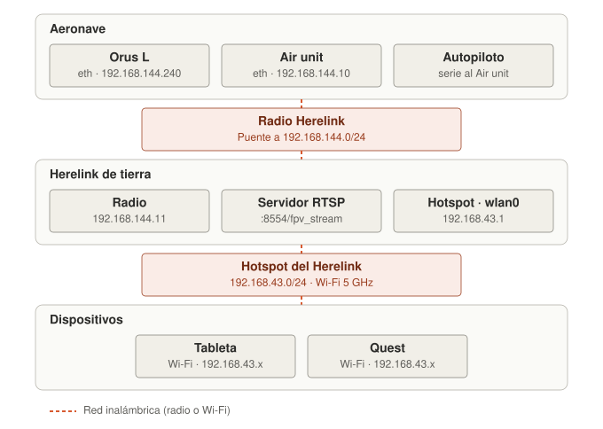
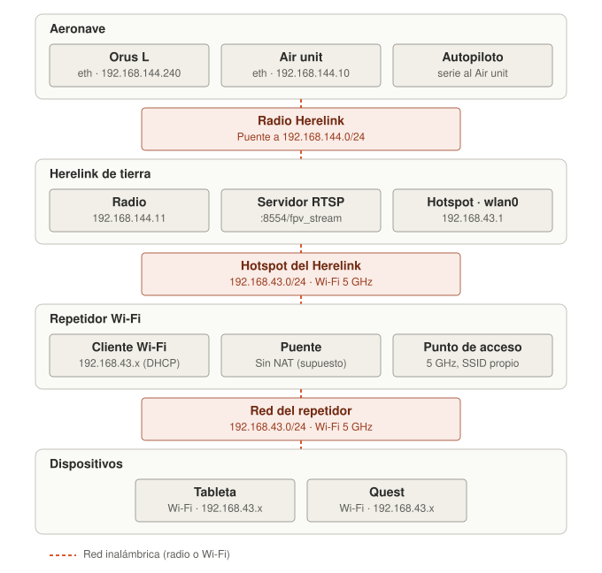
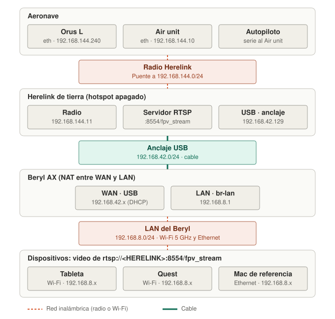
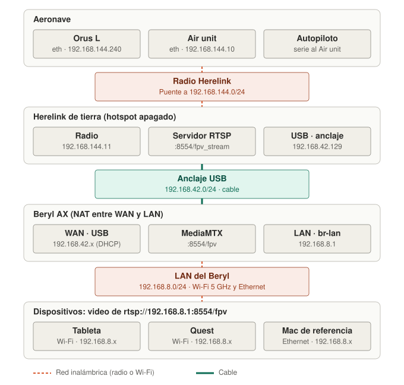

# Prueba: video por un Beryl AX cableado al Herelink, con y sin MediaMTX

Objetivo: saber si un router Beryl AX conectado por USB (tethering) al Herelink de tierra reduce
los congelamientos de video en la tableta y el Quest, y dónde nacen los que queden.

## Por qué

- En el Herelink el video casi nunca se congela; en los dispositivos conectados a su Wi-Fi, sí
  (prueba 2026-11, `docs/protocol/orus-l.md`, "Video holds through the Herelink"). Hoy los
  dispositivos entran por un repetidor Wi-Fi de 5 GHz: dos saltos inalámbricos.
- Un PC con Windows en el tethering USB del Herelink mostró los mismos congelamientos, así que
  el Wi-Fi no es la única causa. De dónde vienen no está resuelto.
- El Beryl hace NAT entre su red y el Herelink. La app pide el video por RTP/UDP a un puerto
  propio y no envía nada que abra el NAT (`core/src/video/video_receiver.cpp`): es probable que
  el UDP no pase y la app caiga a TCP, donde cada pérdida es retraso *(sin verificar)*.
- MediaMTX en el Beryl sería el único cliente del Herelink (por el cable) y serviría el video a
  los dispositivos en su propia red, sin NAT de por medio. Su registro además dice si al Beryl
  le llegan huecos desde el Herelink.

## Esquemas de conexión

En los cuatro montajes la parte de arriba (aeronave, radio, Herelink) es la misma, y el control
de la Orus L va siempre a `192.168.144.240`, enrutado por el Herelink. Lo que cambia es cómo
llegan los dispositivos al Herelink.

Direcciones confirmadas (`docs/protocol/orus-l.md`): la Orus L, el hotspot `192.168.43.1` y el
puerto y la ruta del RTSP. El resto son supuestos a confirmar en el sitio: Air unit `.10` y
radio de tierra `.11` (valores habituales de Herelink), anclaje USB `192.168.42.129` (habitual
en Android), LAN del Beryl `192.168.8.1` (valor de fábrica) y que el repetidor sea un puente
sin NAT.

### 1. Conexión directa al hotspot del Herelink

Un solo salto Wi-Fi y sin NAT. Es el montaje que se degradaba cuando alguien se paraba cerca
del Herelink.



### 2. Repetidor Wi-Fi (montaje de hoy, paso 1)

La misma red del hotspot, con un segundo salto Wi-Fi.



### 3. Beryl AX por cable, solo NAT (fase A)

El salto del Herelink al router pasa a cable. Aparecen dos redes nuevas y el NAT del Beryl
entre los dispositivos y el servidor RTSP del Herelink.



### 4. Beryl AX por cable, con MediaMTX (fases B y C)

El mismo cableado. Los dispositivos piden el video al Beryl, en su propia red; el Beryl
mantiene una única sesión con el Herelink por el cable.



## Hipótesis

| | Hipótesis | Paso que la prueba |
|---|---|---|
| H1 | Detrás del Beryl se alcanza el RTSP del Herelink y el control de la Orus L | 4 y 5 |
| H2 | El NAT del Beryl bloquea el RTP/UDP y la app cae a TCP | 4 |
| H3 | Con MediaMTX el video llega por UDP a varios dispositivos a la vez | 8 y 9 |
| H4 | Los congelamientos que quedan nacen antes del Beryl (Herelink o enlace de radio) | 10 y 12 |
| H5 | Los que solo ve la tableta son de su Wi-Fi y ceden con **Keep Wi-Fi awake** o **Smoothing** | 11 |

## Material

- Herelink de tierra y aeronave con la Orus L, como en vuelo.
- Beryl AX (GL-MT3000) y cable USB al Herelink.
- Mac con el repositorio compilado (`build/tools/imago-cli/imago-cli`) y un **cable Ethernet al
  puerto LAN del Beryl**: es la referencia sin Wi-Fi.
- Tableta y Quest con la app.
- MediaMTX para Linux ARM64, descargado de antemano en la Mac desde
  `https://github.com/bluenviron/mediamtx/releases` (el archivo `..._linux_arm64.tar.gz`). En
  campo el Beryl no tiene internet.

## Reglas

- **Un cambio a la vez** y anotar cada resultado en el registro del final.
- En cada paso con video, anotar del HUD **Frame gaps p95 / max** y los avisos que salgan
  ("Video over TCP: UDP did not get through", "VIDEO FROZEN", "VIDEO RECONNECTING…").
- Activar **Detailed log** y **Record log** en la app antes de cada paso con video; anotar el
  nombre del `.tlog`.
- Fases A y B en tierra, **sin hélices**. La fase C es en vuelo.

## Fase A: el Beryl solo (banco)

1. **Línea base.** Con el montaje de hoy (repetidor), conectar la tableta, ver video 3 minutos
   moviendo el gimbal y haciendo zoom. Anotar Frame gaps y número de congelamientos.

2. **Conectar el Beryl.** Apagar el repetidor y el **hotspot del Herelink**. Conectar el Beryl
   por USB al Herelink y activar en el Herelink **Anclaje de USB** (Ajustes de Android → Red →
   Zona Wi-Fi/Anclaje). En el panel del Beryl (`http://192.168.8.1` → Internet → Tethering)
   comprobar que tomó dirección. **Anotar la IP del Beryl y su puerta de enlace**: la puerta de
   enlace es el Herelink (en Android suele ser `192.168.42.129`). En adelante, `<HERELINK>`.

3. **Wi-Fi del Beryl.** Solo 5 GHz, canal fijo no DFS (36–48 o 149–161), ancho 20 o 40 MHz, sin
   band steering. En la tableta y el Quest, olvidar la red del Herelink y la del repetidor.

4. **Video a través del NAT (H1, H2).** Mac por cable al Beryl, Wi-Fi de la Mac apagado:

   ```sh
   ./build/tools/imago-cli/imago-cli - --rtsp rtsp://<HERELINK>:8554/fpv_stream --every 1 --log paso4.txt
   ```

   - Hay métricas de video y no sale aviso de TCP → el UDP pasa el NAT: H2 falsa.
   - Sale "Video over TCP: UDP did not get through" → H2 cierta. Seguir igual; la fase B lo
     resuelve.
   - No conecta → revisar la IP del paso 2 y que el anclaje siga activo.

5. **Control de la Orus L a través del NAT (H1).**

   ```sh
   ./build/tools/imago-cli/imago-cli 192.168.144.240 --tlog paso5.tlog
   ```

   Debe aparecer el estado del gimbal. Escribir `rate 10 0`, ver que se mueve, y `rate 0 0`.
   Si se queda en espera, el Herelink no enruta del anclaje a `192.168.144.x` o la respuesta de
   la Orus L no vuelve por el NAT: anotarlo y **no seguir a la fase C** (haría falta un relé de
   MAVLink en el Beryl; queda fuera de esta prueba).

6. **Tableta y Quest, sin MediaMTX.** Duplicar el perfil **Orus L · Herelink**, poner en
   **Video (RTSP)** `rtsp://<HERELINK>:8554/fpv_stream`, modo **Payload IP**, **Transport**
   Auto. Ver video 3 minutos moviendo el gimbal y con zoom. Anotar avisos y Frame gaps.

## Fase B: MediaMTX en el Beryl (banco)

7. **Instalar.** Desde la Mac, por cable (el `-O` es porque el Beryl no trae servidor SFTP):

   ```sh
   tar xzf mediamtx_*_linux_arm64.tar.gz mediamtx
   scp -O mediamtx root@192.168.8.1:/usr/bin/mediamtx
   ```

   Crear en la Mac `mediamtx.yml` con `<HERELINK>` sustituido y copiarlo igual a
   `/etc/mediamtx.yml`:

   ```yaml
   logLevel: info
   logDestinations: [stdout, file]
   logFile: /tmp/mediamtx.log        # en RAM: copiarlo antes de apagar el Beryl

   rtspTransports: [udp, tcp]
   rtspAddress: :8554
   hls: false
   webrtc: false
   rtmp: false
   srt: false

   paths:
     fpv:
       source: rtsp://<HERELINK>:8554/fpv_stream
       rtspTransport: tcp            # por el cable no hay pérdidas: TCP no penaliza
       sourceOnDemand: false         # siempre conectado: el video aparece al instante
   ```

   Estos nombres son los del `mediamtx.yml` actual (2026-11); si la versión descargada no
   arranca por una clave desconocida, comparar con el `mediamtx.yml` que viene en el `.tar.gz`.

   Arranque automático: crear `/etc/init.d/mediamtx` en el Beryl con

   ```sh
   #!/bin/sh /etc/rc.common
   START=99
   USE_PROCD=1
   start_service() {
       procd_open_instance
       procd_set_param command /usr/bin/mediamtx /etc/mediamtx.yml
       procd_set_param respawn
       procd_close_instance
   }
   ```

   y ejecutar en el Beryl:

   ```sh
   chmod +x /usr/bin/mediamtx /etc/init.d/mediamtx && /etc/init.d/mediamtx enable && /etc/init.d/mediamtx start
   ```

   Comprobar con `tail -f /tmp/mediamtx.log` que el path `fpv` queda listo con la pista H.264.

8. **Video desde MediaMTX, por cable (H3).**

   ```sh
   ./build/tools/imago-cli/imago-cli - --rtsp rtsp://192.168.8.1:8554/fpv --every 1 --log paso8.txt
   ```

   Debe haber video **sin** aviso de TCP. Dejarlo corriendo: es la referencia de los pasos
   siguientes.

9. **Tableta y Quest a la vez (H3).** En el perfil duplicado, **Video (RTSP)** =
   `rtsp://192.168.8.1:8554/fpv`. Conectar los dos. Ver video 3 minutos moviendo el gimbal y con
   zoom. Anotar avisos y Frame gaps de cada uno, y comparar el retraso a ojo contra la pantalla
   del Herelink (apuntar la cámara a un cronómetro).

10. **Dónde nace cada congelamiento (H4).** Con la Mac del paso 8 corriendo y la tableta a la
    vista, en cada congelamiento de la tableta anotar la hora y mirar:

    | La Mac por cable | El registro de MediaMTX | Conclusión |
    |---|---|---|
    | También se detiene | Paquetes RTP perdidos o la fuente se reconecta | Nace en el Herelink o en la radio |
    | También se detiene | Nada | El Herelink deja de enviar sin huecos (retiene y suelta) |
    | Sigue fluida | Nada | Es el Wi-Fi del Beryl o el dispositivo |

    Mirar también si la pantalla del Herelink se detuvo en ese momento.

11. **Lado del dispositivo (H5).** Solo si en el paso 10 hubo congelamientos que la Mac no vio.
    En el perfil, de uno en uno y reconectando cada vez: **Keep Wi-Fi awake (experimental)**
    activado; luego apagarlo y probar **Smoothing** 100 ms. Anotar Frame gaps con cada uno.

## Fase C: en vuelo

12. Repetir los pasos 9 y 10 durante un vuelo como el de 2026-11 (aeronave a ~1 km), con la Mac
    por cable registrando (`--log vuelo.txt`) y, si se puede, anotando el RSSI que muestra el
    Herelink en cada congelamiento. Al aterrizar, **antes de apagar el Beryl**:

    ```sh
    scp -O root@192.168.8.1:/tmp/mediamtx.log mediamtx-vuelo.log
    ```

    Guardar ese registro, `vuelo.txt` y los `.tlog` de la tableta y el Quest.

## Registro

| Paso | Montaje | Dispositivo | Transporte (UDP/TCP) | Frame gaps p95 / max | Congelamientos en 3 min | `.tlog` / log | Notas |
|---|---|---|---|---|---|---|---|
| 1 | Repetidor | Tableta | | | | | |
| 4 | Beryl, NAT | Mac (cable) | | | | | |
| 5 | Beryl, NAT | Mac (cable) | control: sí / no | | | | |
| 6 | Beryl, NAT | Tableta | | | | | |
| 6 | Beryl, NAT | Quest | | | | | |
| 8 | MediaMTX | Mac (cable) | | | | | |
| 9 | MediaMTX | Tableta | | | | | |
| 9 | MediaMTX | Quest | | | | | |
| 11 | MediaMTX + Keep Wi-Fi awake | Tableta | | | | | |
| 11 | MediaMTX + Smoothing 100 ms | Tableta | | | | | |
| 12 | MediaMTX, vuelo | Tableta / Quest / Mac | | | | | |

IP del Beryl en el anclaje: ________  Puerta de enlace (`<HERELINK>`): ________
Versión de MediaMTX: ________  Canal y ancho del Wi-Fi: ________

## Qué hacer con el resultado

- **H2 cierta y MediaMTX lo resuelve** → MediaMTX queda como montaje recomendado; pasarlo al
  manual de usuario.
- **Congelamientos también en la Mac por cable (H4)** → el Wi-Fi no es la causa: llevar el
  registro de MediaMTX y el RSSI a `docs/protocol/orus-l.md` con la fecha, y probar un bitrate
  menor en **Settings › Stream**.
- **Solo en la tableta o el Quest** → ajustar el Wi-Fi del Beryl (canal, ancho, posición) y las
  opciones del paso 11.
- **El paso 5 falla** → hace falta un relé de MAVLink en el Beryl antes de volar con este
  montaje.
